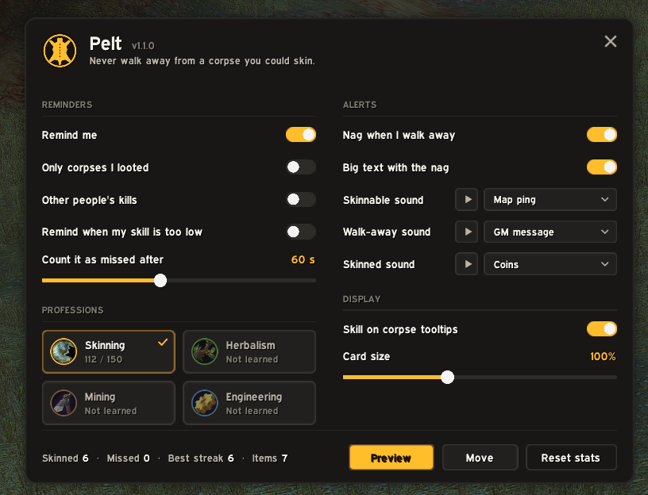

# Pelt

**Never walk away from a corpse you could skin.** For WoW Forever, and Burning Crusade Anniversary.

You kill a boar, loot it, and run off to the next one. Pelt notices the corpse turned skinnable, reminds you, nags if you walk away, and ticks it off when you skin it.

## What it does

- **Spots skinnable corpses.** When a corpse you killed turns skinnable, a card slides in: what it is, the skill it needs and yours. Pelt reads the corpse's tooltip and the cursor it shows, so the skinning knife is enough.
- **Catches the ones that dropped nothing.** No loot sparkle, no right-click, easy to forget. Pelt picks them up once the fight ends.
- **Nags when you walk off.** Move away without skinning and the card shakes, a sound plays and "Skin the Mottled Boar!" flashes on screen.
- **Knows when you're on it.** Point at the corpse and the card lights up with "Right-click to skin". It fills up while you skin.
- **Ticks it off.** Skin it and the card turns green, showing what you got, any skill-up and your streak.
- **Counts the misses.** If a corpse sits too long, it counts as missed. Mouse over it again and it comes back.
- **Learns as you go.** Once Pelt has seen a creature's corpse turn skinnable, it reminds you about that creature even if you never look at the corpse again.
- **Tooltip hint.** Under the game's "Skinnable" line: the skill it needs and yours, green or red.
- **Not just skinning.** Corpses you gather with Herbalism, Mining or Engineering on Burning Crusade Anniversary work the same way.

It stays quiet when it should:
- In a fight, the card waits ("After the fight"), and time in combat doesn't count toward a miss.
- Professions you don't have and corpses your skill is too low for are skipped. You can turn on reminders for low-skill corpses.
- Someone else's kill you point at or target shows up as "Up for grabs". Passing one up doesn't count as a miss, and you can turn these off.

## Commands

| Command | |
|---|---|
| `/pelt` | Settings |
| `/pelt test` | Preview the card, the nag and the tick |
| `/pelt move` | Drag the card somewhere else (again to lock) |
| `/pelt stats` | What you've skinned and missed |
| `/pelt check` | What Pelt can read off your target |

The settings are also under Esc → Options → AddOns → Pelt, and in the addon compartment on the minimap.

## Settings

- **Reminders:** on or off, only corpses you looted, other people's kills, corpses your skill is too low for, and how long until a corpse counts as missed (15–120 seconds).
- **Professions:** pick which of Skinning, Herbalism, Mining and Engineering to remind you about.
- **Alerts:** the walk-away nag, the big text, and a sound for each moment. Every sound has a play button, in the list and next to it. Pick from Pelt's own sounds, the game's, EllesmereUI's and any SharedMedia packs.
- **Display:** the tooltip hint and the card size.

## WoW Forever notes

Forever doesn't give addons the combat log, and in combat it hides other units' names and IDs. Pelt works from what's left: your loot windows, the corpse's tooltip and cursor, and your skinning casts. Anything it can't read in a fight, it reads the moment combat ends.

If a corpse isn't picked up, target it and type `/pelt check`. It lists what Pelt can see.

## Install

Extract the `Pelt` folder into your AddOns folder, for example `World of Warcraft\_forever_\Interface\AddOns`, then restart the game.

---

**Author:** muggles · **Twitch:** [twitch.tv/muggles](https://twitch.tv/muggles)
